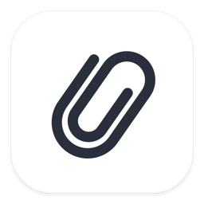
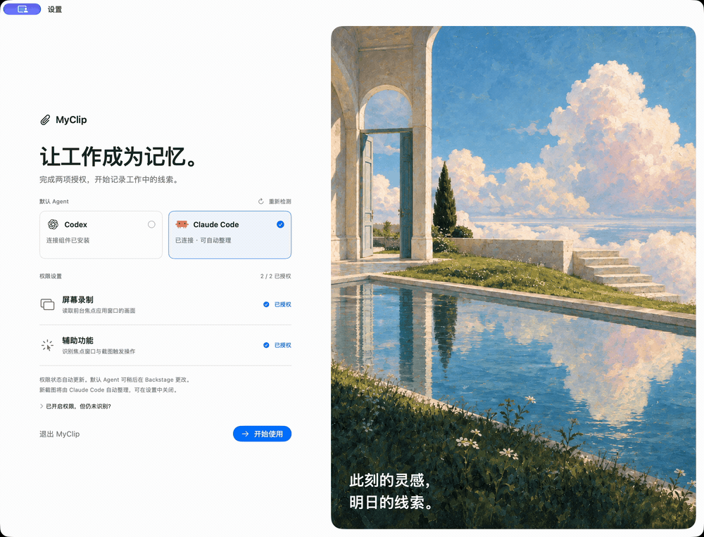

<div align="center">
  
  <h1 align="center">MyClip</h1>
  <p align="center">MyClip vous aide à retrouver le fil de votre travail. Il capture la fenêtre active ou l’écran qui la contient sur votre Mac et utilise Codex ou Claude pour transformer les captures en notes consultables, en connaissances reliées et en suggestions de tâches.</p>
</div>

<p align="center">
  <a href="../README.md">English</a> · <a href="README.zh-CN.md">简体中文</a> · <a href="README.es.md">Español</a> · <strong>Français</strong> · <a href="README.de.md">Deutsch</a> · <a href="README.ja.md">日本語</a> · <a href="README.ko.md">한국어</a>
</p>

[Télécharger pour macOS](https://github.com/section9-lab/MyClip/releases) (Apple Silicon / Intel). Nécessite macOS 13+, un compte Codex ou Claude et Node.js 22+ pour le connecteur d’agent. [Ouvrir les versions auto-signées](release-signing.md).

<p align="center">
  <a href="https://section9-lab.github.io/MyClip/demo/"></a>
</p>
<p align="center"><a href="https://section9-lab.github.io/MyClip/demo/">Voir en haute définition</a> · <a href="images/myclip-demo.mp4">Télécharger le MP4</a></p>
<p align="center"><sub>Démo HTML de 45 secondes · Données d’exemple · Interface en chinois.</sub></p>

## Ce que vous pouvez faire

- **Retrouver votre travail.** Parcourez la chronologie des captures et consultez les sources de vos notes. Chaque capture possède un document OCR local à lire, copier ou ouvrir.
- **Constituer une bibliothèque personnelle.** Recherchez, modifiez et reliez les notes de vos projets, sujets et activités quotidiennes. Ce sont des fichiers Markdown, également lisibles dans d’autres éditeurs.
- **Suivre les prochaines étapes.** Examinez les tâches proposées, confirmez celles qui comptent et suivez leur avancement sur un tableau. Passez de **Kanban** à **Reports** pour consulter des rapports quotidiens, hebdomadaires ou mensuels organisés par projet et par avancement.
- **Donner du contexte à vos outils d’IA.** Autorisez Codex, Claude Code, Claude Desktop, Cursor ou OpenCode à rechercher dans vos souvenirs enregistrés.

## Confidentialité et contrôle

- **Choisissez ce qui est capturé.** Les réglages regroupent trois contrôles : la portée (fenêtre active par défaut ou écran qui la contient), les déclencheurs indépendants de la souris (clic dans les 5 s après déplacement de la souris, pause de 3 s après défilement vers le bas) et le déclencheur clavier (lettres puis Entrée par défaut, ou chaque Entrée). La capture fonctionne tant que MyClip est ouvert ; quittez l’application pour l’arrêter. Vous pouvez exclure certaines applications, y compris lors de la capture de l’écran entier.
- **Gardez votre bibliothèque en local.** Captures et notes sont stockées sur votre Mac. Les captures originales expirent après 30 jours par défaut ; les notes enregistrées restent disponibles. Vous pouvez modifier cette durée dans les réglages.
- **Décidez quand utiliser l’IA.** L’organisation utilise le service du modèle de l’agent choisi, qui peut traiter captures et notes dans le cloud. Désactivez l’organisation automatique pour garder les nouvelles captures en local jusqu’au moment où vous décidez de les traiter.

<details>
<summary>Compiler depuis les sources</summary>

Nécessite Xcode 26, Swift 6.2 et XcodeGen.

```sh
xcodegen generate
bash Scripts/test.sh
xcodebuild -project MyClip.xcodeproj -scheme MyClip -configuration Debug build
```

Pour créer un DMG, exécutez `Scripts/package_dmg.sh`. Le résultat est `dist/MyClip-<version>.dmg`.

Pour créer des paquets distincts pour Apple Silicon et Intel, exécutez `MYCLIP_ARCH=arm64 bash Scripts/package_dmg.sh` ou `MYCLIP_ARCH=x86_64 bash Scripts/package_dmg.sh`. Leurs noms se terminent respectivement par `-arm64.dmg` et `-x86_64.dmg`. Le push d’un tag `v<version>` déclenche les tests et la création des deux paquets dans GitHub Actions, puis une Release contenant les deux DMG et `SHA256SUMS`. Le tag doit correspondre à `CFBundleShortVersionString`, avec les notes dans `docs/releases/v<version>.md`.

</details>
