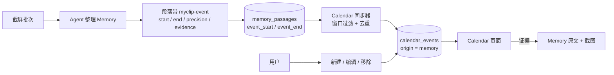

# Calendar 设计（草稿，待确认）

目标：在左侧导航 Kanban 下方增加 **Calendar**，把 AI 整理 Memory 时识别到的会议、出行等明确日程自动放进日历；同时允许手动新建、修改、移除。

---

## 1. 先说调研结论

### 1.1 项目现状

| 项 | 值 | 依据 |
|---|---|---|
| 最低系统 | macOS 13.0 | `project.yml` → `deploymentTarget.macOS: "13.0"` |
| Swift | 6.0 | `project.yml` → `SWIFT_VERSION: "6.0"` |
| 日历相关现成数据 | **已有**：Memory 段落带 `<!-- myclip-event {start,end,precision,evidence} -->` 注解，索引到 `memory_passages.event_start/event_end` | `MyClip/Core/Memory/MemoryPassage.swift`、`MemoryRules.swift`、`LibrarySchema.swift` |
| 三方依赖 | 只有 Sparkle / Mixpanel / MarkdownUI；项目规范限制新增依赖 | `project.yml` |

结论：**AI 日程的数据源已经存在，不需要新的 Agent 协议**。这是本设计最大的省力点。

### 1.2 SwiftUI 到底有没有"日历组件"

用本机已安装的 SDK（Xcode 27.2 / macosx27.2）直接查 `SwiftUI.swiftinterface`：

```bash
SDK=$(xcrun --show-sdk-path)
grep -n "MultiDatePicker" -A4 \
  "$SDK/System/Library/Frameworks/SwiftUI.framework/Modules/SwiftUI.swiftmodule/x86_64-apple-macos.swiftinterface"
# @available(iOS 16.0, *)
# @available(macOS, unavailable)   ← macOS 明确不可用
```

| 候选 | 可用性 | 能否显示事件 | 结论 |
|---|---|---|---|
| `DatePicker(...).datePickerStyle(.graphical)` | macOS 10.15+（自定义 `makeBody` 13.0+） | ❌ 只能选日期 | 尺寸固定、不能放大，**不用于主界面** |
| `MultiDatePicker` | `@available(macOS, unavailable)` | ❌ | 不可用 |
| AppKit `NSDatePicker`（`.clockAndCalendar`） | macOS 10.4+ | ❌ | 不额外引入 AppKit 控件 |
| 自定义 `LazyVGrid` 月格 | macOS 13+ | ✅ 可画事件点 | **采用** |

> 我没在仓库或本机找到一份叫《SwiftUI macOS 开发指南》的文档。这里把它理解为 Apple SwiftUI 的 `DatePicker(.graphical)`。实际试做后发现它的字号和格子在 macOS 上固定且偏小，撑不起日历页，并且没有"给某天画事件点"的 API（初始化器只有 `selection` / `range` / `label`，没有 day content 闭包）。因此最终改为：

- 左栏：自绘的大月格（40pt+ 单元格、事件点、蓝圈选中），保持系统蓝色与原生排版
- 主区：`日 / 周 / 月` 三种视图；周视图是默认
- 时间轴与事件卡：自绘，无第三方依赖
- 数据层不依赖视图形态

---

## 2. 产品流程



关键原则（对齐 `.impeccable.md`）：

- 每条 AI 日程都能点回 Memory 原文与截图，不凭空生成。
- 日期/时间只来自 `myclip-event` 注解，**不从标题猜时间**。
- 没有明确日期的事件不会出现在日历里（宁缺毋滥）。
- 用户改过的 AI 日程，后续同步不再覆盖。

---

## 3. 信息架构与线框

侧栏位置（`LibraryPage` 增加 `calendar`）：

```
资料库
  Memory
  Timeline
  Kanban
  Calendar      ← 新增，symbol: "calendar"
  Backstage
```

页面线框（默认周视图，窗口 1240×820；最小 840×580 时隐藏左栏）：

```
┌────────────────────────────┬─────────────────────────────────────────────┐
│ ‹  11月15日 – 21日  ›       │         [日] [周] [月]   今天   ＋ 新建日程  │
├────────────────────────────┼─────────────────────────────────────────────┤
│  2026年11月            ‹ ›  │  周日   周一   周二   周三   周四   周五  周六│
│  日 一 二 三 四 五 六       │   15     16     17     18     19     20    21│
│   1  2  3  4  5  6  7       │  全天  ✈上海出差  ✈上海出差                  │
│   8  9 10 11 12 13 14       │  07:00 ┃                                    │
│  15 16 17 18 19 20 21       │  09:00 ┃  ▢产品评审 ▢设计走查                │
│  22 23 24 25 26 27 28       │  10:00 ┃  ▢客户电话确认…                    │
│  29 30  1  2  3  4  5       │  14:00 ━━━━━━━━━━━━━━━━━━━━━ 现在           │
│ ─────────────────────       │  15:00 ┃  ▢客户电话                          │
│  11月16日 周一       4 项    │  18:00 ┃              ▢提交 0.7 版本         │
│  全天  ✈ 上海出差            │                                             │
│  9:30–10:15  产品评审        │                                             │
│  9:45–10:30  设计走查        │                                             │
│  15:00–16:00 客户电话        │                                             │
└────────────────────────────┴─────────────────────────────────────────────┘
```

- 左栏 300pt：自绘月格 + 选中日日程列表；窗口窄于 820pt 或月视图时隐藏。
- 月视图使用整页 7 列大月格，每格最多 3 条日程 + “还有 N 项”。
- 周视图 7 列、`日/周/月` 分段控件、红色当前时间线；重叠日程用 12pt 错位堆叠，保证窄列也能读到标题。
- 顶部沿用 Kanban 的紧凑头部，不加额外大标题；系统分隔线，无渐变/阴影。

### 3.1 日视图

- 时间轴默认 07:00–22:00，按当天最早/最晚事件自动扩展；每小时 52pt，开机滚到当前时间附近（`ScrollViewReader`）。
- `TimelineView(.periodic(from:by:60))` 画当前时间红线。
- 日视图重叠事件按"贪心分栏"并排，列宽均分；周视图列窄，改用 12pt 错位堆叠。
- 全天/跨天事件固定在顶部"全天"带；跨天出行按天拆成连续段（首日左圆角、末日右圆角）。
- 事件卡片：白底（`textBackgroundColor`）+ 8pt 圆角 + 3pt 左侧色条；AI 来源显示 `✦` 与可点证据；会议 = 蓝、出行 = 青、截止 = 橙、其他 = 灰。
- 点击事件打开详情 sheet（时间、项目、备注、原文依据、来源 Memory、编辑、移除）。
- 右键菜单：编辑 / 移除 / 在 Memory 中显示 / 从任务安排（后续）。

### 3.2 月历栏与月视图

- 自绘 7 列月格：单元格 40pt+，事件点最多 3 个；今天用蓝圈，选中日蓝底白字，相邻月份灰显。
- 月格下方是"选中日日程"：时间（开始/结束）+ 色条 + 标题，点击打开详情。
- `月` 模式使用整页月格：每格最多 3 条日程 + “还有 N 项”，右键可新建；左栏隐藏。
- 月格数字是独立 Button，可用键盘聚焦；月视图的空白处点击选中该天。

---

## 4. 数据模型（schema v17）

新增两张表，沿用 task 的"证据 + 来源"思路：

```sql
CREATE TABLE IF NOT EXISTS calendar_events (
    id TEXT PRIMARY KEY,
    identity TEXT NOT NULL UNIQUE,      -- 去重键
    title TEXT NOT NULL,
    notes TEXT NOT NULL DEFAULT '',     -- 用户备注
    location TEXT NOT NULL DEFAULT '',
    project TEXT NOT NULL DEFAULT '',
    kind TEXT NOT NULL DEFAULT 'other', -- meeting / travel / deadline / other
    start_at REAL NOT NULL,
    end_at REAL NOT NULL,
    is_all_day INTEGER NOT NULL DEFAULT 0,
    state TEXT NOT NULL DEFAULT 'scheduled', -- scheduled / dismissed
    origin TEXT NOT NULL DEFAULT 'user',     -- user / memory
    evidence TEXT NOT NULL DEFAULT '',       -- 原文依据（只读展示）
    memory_id TEXT REFERENCES entries(id) ON DELETE SET NULL,
    task_id TEXT REFERENCES work_tasks(id) ON DELETE SET NULL,
    edited_at REAL,                          -- 用户改过后，同步不再覆盖
    created_at REAL NOT NULL,
    updated_at REAL NOT NULL
);
CREATE INDEX IF NOT EXISTS calendar_events_start ON calendar_events(start_at);
CREATE INDEX IF NOT EXISTS calendar_events_range ON calendar_events(start_at, end_at);

CREATE TABLE IF NOT EXISTS calendar_event_sources (
    event_id TEXT NOT NULL REFERENCES calendar_events(id) ON DELETE CASCADE,
    capture_id TEXT NOT NULL REFERENCES captures(id),
    PRIMARY KEY(event_id, capture_id)
);
```

- 迁移：`prepareDatabase` 里 `if version < 17 { create tables; PRAGMA user_version=17; }`，同时把"资料库版本过新"的 guard 提到 17。
- 不改 `memory_passages`；同步时按 `start_offset/end_offset` 从 Memory 文件切片，拿到原文。
- `is_all_day = (precision == "day")`；`end` 沿用 Memory 的**开区间**语义（整天事件的 end 是次日 00:00）。
- 时区：存绝对时间；展示用当前时区。`myclip-event` 的偏移已在解析时保留。

### 4.1 同步算法（幂等）

```
synchronizeCalendarEvents(now):
  1. 选 memory_passages 中 event_start IS NOT NULL
     且 event_end >= 今天 00:00
     且 event_start <= now + 365 天
  2. 按 entry_id 读 Memory 正文（走 MemoryReadCache），
     用 start_offset..<end_offset 切片
  3. title = 去掉注释/列表符/Markdown 后的首行，截 120 字；空则用 Memory 标题
     evidence = 切片原文，截 1200 字
  4. identity = sha256("memory\n" + entryID + "\n" + evidence)
  5. INSERT INTO calendar_events ... ON CONFLICT(identity) DO UPDATE
       SET start_at/end_at/title/evidence = ...
       WHERE calendar_events.origin='memory'
         AND calendar_events.edited_at IS NULL
         AND calendar_events.state='scheduled'
```

- **只在"未结束"时自动导入**（`event_end >= 今天 00:00`）：日历是排期工具，不把一个月前的历史事实塞进来；已经导入的事件不会因时间过去而消失。
- **去重键用 `memoryID + evidence`**：AI 修正日期时更新同一条，不产生重复；同一段被重复写入也只保留一条。
- **不删除**：v1 同步只增改、不清理。AI 删掉注解后旧事件仍保留，由用户移除（后续可加 `last_seen` 两轮未出现再软删除）。
- 触发时机：
  - Calendar 页首次出现（`task`）
  - 每次 Memory 批处理完成后（`refresh` 的 calendar token 变化）
  - 用户点"刷新"或切回页面

### 4.2 AI 事件从哪来（不用改 Agent 协议）

Memory 规则已经要求：

> `<!-- myclip-event {"start":"…","end":"…","precision":"range","evidence":"…"} -->`

所以 v1 **不需要新的 tasks/events JSON**，现有 Agent 输出直接可用。

可选增强（建议 Phase 2）：给注解加**可选** `kind`，老 Agent 不填也不报错（`JSONDecoder` 忽略未知字段）：

```json
<!-- myclip-event {"start":"2026-11-15T09:00:00+08:00","end":"2026-11-15T10:00:00+08:00",
                   "precision":"range","kind":"meeting","evidence":"11月15日上午9点产品评审"} -->
```

规则里加一句："`kind` 可选，只能是 meeting / travel / deadline / other；只按原文明确语义标注，不猜测。" UI 缺省按 `other` 显示。

### 4.3 用户操作

| 操作 | 行为 |
|---|---|
| 新建 | `origin=user`，`identity="manual:"+UUID`，默认选中日 09:00–09:30 |
| 编辑 AI 日程 | 写 `edited_at`；保留 `memory_id/evidence`，显示"已手动调整" |
| 移除 AI 日程 | `state=dismissed`，同步不再把它恢复 |
| 移除用户日程 | 同样 `state=dismissed`（保留可追溯，界面不显示） |
| 全天 | `is_all_day=1`，start 取当地 00:00，end = 次日 00:00 |

校验：标题 1–240 字；`end > start`；跨天最多 366 天；项目 ≤120 字；备注 ≤2000 字。

---

## 5. UI 状态

| 状态 | 表现 |
|---|---|
| 加载 | 时间轴骨架 + 左栏 spinner，不闪空状态 |
| 错误 | 顶部提示条（复用 `noticeBanner` 样式）+ 重试 |
| 空（当天） | "今天没有日程" + 新建日程；AI 说明放在下面一行 caption |
| 空（本月） | "这个月还没有日程。AI 整理后会在这里加入会议和出行。" |
| 仅全天 | "全天"带单独一段，不占时间轴 |
| 已过时间 | 正常显示；当前时间线以下降低对比度（可选） |

---

## 6. 文件与改动点

新增：

```
MyClip/Core/Calendar/CalendarEvent.swift       模型、Kind/Origin/State、Draft
MyClip/Core/Calendar/CalendarStore.swift       迁移后的读写、同步、CRUD
MyClip/Core/Calendar/CalendarLayout.swift      月分组、重叠分栏、跨天拆分（纯函数，可测）
MyClip/App/Model/MyClipModel+Calendar.swift    加载/保存/移除
MyClip/Features/Calendar/CalendarPageView.swift 头部、月格左栏、日/周/月切换
MyClip/Features/Calendar/CalendarDayView.swift  日时间轴、全天带、空状态
MyClip/Features/Calendar/CalendarWeekView.swift 7 列周视图、全天带、当前时间线
MyClip/Features/Calendar/CalendarMonthView.swift 整页月视图
MyClip/Features/Calendar/CalendarStyle.swift    类型颜色与 SF Symbol
MyClip/Features/Calendar/CalendarEventDetail.swift 详情 + 编辑 sheet
Tests/MyClipCoreTests/Calendar/CalendarStoreTests.swift
Tests/MyClipCoreTests/Calendar/CalendarLayoutTests.swift
```

修改：

| 文件 | 改动 |
|---|---|
| `MyClip/App/Model/MyClipModel.swift` | `LibraryPage` 加 `.calendar`；`@Published calendarEvents`；`refresh()` 里按 token 变化加载 |
| `MyClip/App/MyClipRootView.swift` | 侧栏加行；detail switch 加分支 |
| `MyClip/Core/Storage/LibrarySchema.swift` | v17 建表 |
| `MyClip/Core/Storage/LibraryChangeTracking.swift` | `calendar` token 加入 `calendar_events` |
| `MyClip/Core/Prompt/MemoryRules.swift` | （Phase 2）可选 `kind` |
| `MyClip/Supporting/Localizable.xcstrings` | 新文案 |

不改：`TaskPrompt`、`TaskResponse`、`task_ingestions`、`work_tasks`。

---

## 7. 可访问性与键盘

- 月格日期、周视图日期头、日程行都是 Button；月视图日期数字单独可聚焦。
- 每个事件是一个 `Button`（不是一堆 `Text`），label 为"产品评审，9 点到 10 点，会议，来自 AI"。
- 时间轴的 56pt 小时行 `accessibilityHidden(true)`，避免 VoiceOver 逐行朗读。
- 左栏选中日日程用按钮列表；月格日期可 Tab 聚焦。
- 编辑 sheet：`⌘↩` 保存、`Esc` 取消、焦点落在标题；错误 inline 显示。
- 颜色不是唯一信息：kind 同时有图标 + 文字，AI 有 `✦` 和朗读提示。
- 所有动画用系统默认；不引入位移/缩放动画，尊重"减弱动态效果"。

---

## 8. 性能与并发

- `LibraryStore` 是 actor；同步与 CRUD 都是 `async throws`，视图侧 `Task` 调用后 `refresh()`。
- 日历查询按可见月份区间取，不做全表加载；单次最多约 200 行。
- 同步按 Memory 缓存读文件；同一批避免重复读。
- `MyClipModel` 只在日历页或 token 变化时刷新，不参与 15 秒全局巡检的重活。

---

## 9. 测试清单

纯数据/布局（`MyClipCoreTests`）：

- 同一 Memory 重复同步只产生一条事件
- AI 改日期后更新同一条；用户改过后不被覆盖
- `dismissed` 不会被同步恢复
- `precision=day` → 全天，end 为次日
- 跨时区/夏令时边界（+08:00、-05:00、DST 切换日）
- 标题清洗：列表符、`##`、Wikilink、超长截断
- 重叠事件分栏、跨天事件拆分
- 月分组（周一/周日为首日两种 Calendar）

界面测试（`MyClipAppTests`）：

- 侧栏出现 Calendar 并能切换
- 空状态、加载失败提示
- 新建/编辑/移除后时间轴与月列表同步更新

---

## 10. 分期

**Phase 1（已实现）**
侧栏入口、schema v17、Memory 自动同步、手动 CRUD、自绘大月格、日/周/月三种视图、全天带、重叠分栏、证据跳转、A11y、核心测试。

**Phase 2（可选）**
- `kind` 注解扩展（会议/出行/截止的图标与颜色更准）
- 拖拽改期、周/日视图直接框选新建
- 日历搜索（侧栏搜索框接入）
- 已完成：大月格 + 事件点、周视图

**Phase 3（可选，需权限）**
- 单向导出到系统日历（EventKit，需要 `NSCalendarsFullAccessUsageDescription` / `NSCalendarsUsageDescription` 与沙盒 entitlement）
- 本地提醒通知

---

## 11. 已确认的实现取舍

1. **自动加入**：AI 识别到的未来日程直接进日历（带 `✦` 和证据），不做二次确认；用户可编辑或移除。
2. **月视图**：主界面用自绘大月格 + 日/周/月切换（原生 graphical DatePicker 尺寸固定、无法显示事件点）。
3. **名称**：侧栏用英文 `Calendar`（和 Kanban/Memory 一致）。
4. **历史事件**：只自动导入"还没结束"的日程；已导入的不会因时间过去而消失。
5. **系统日历**：Phase 1 不做 EventKit 导出。
6. **kind 扩展**：Phase 1 不修改 Agent 协议；AI 日程默认 `other`，会议/出行/截止可手动选择。
